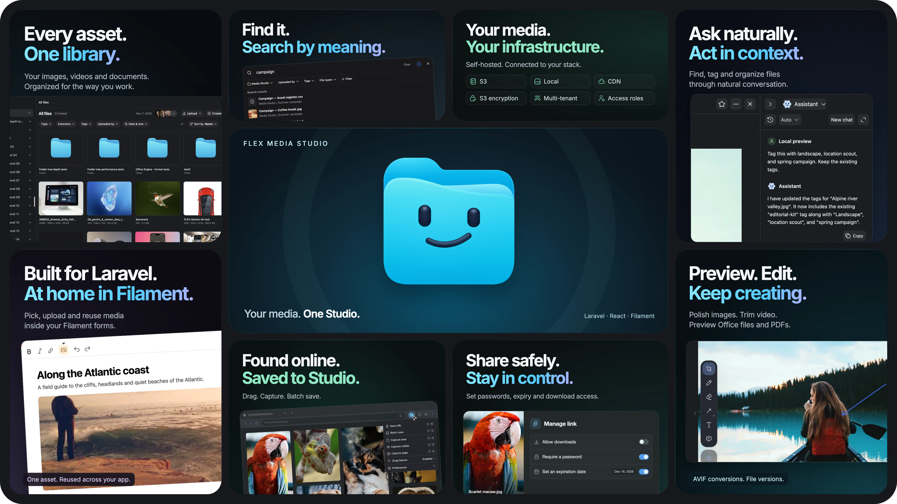
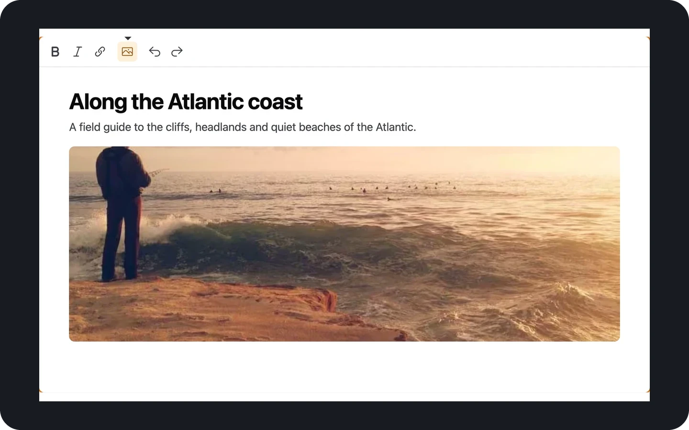
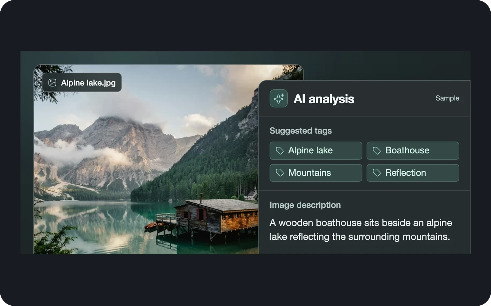
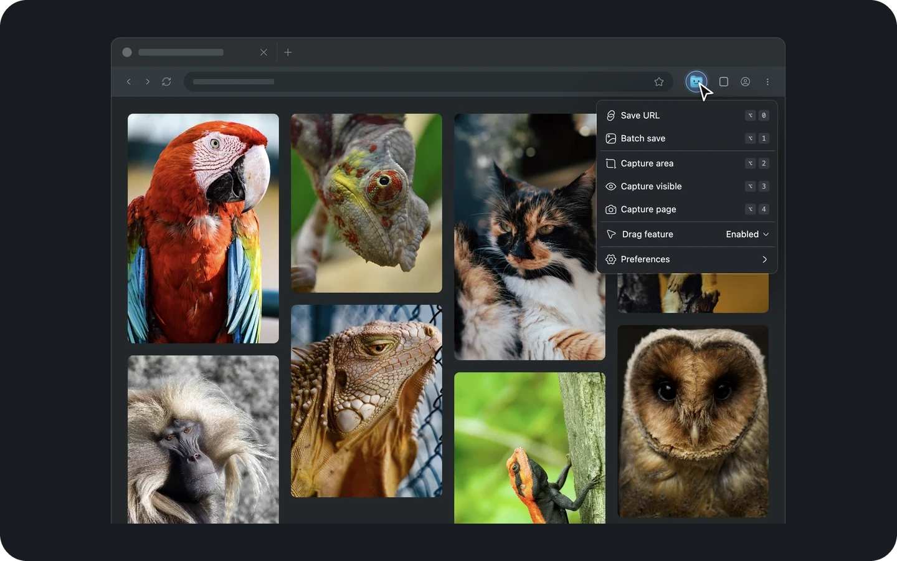
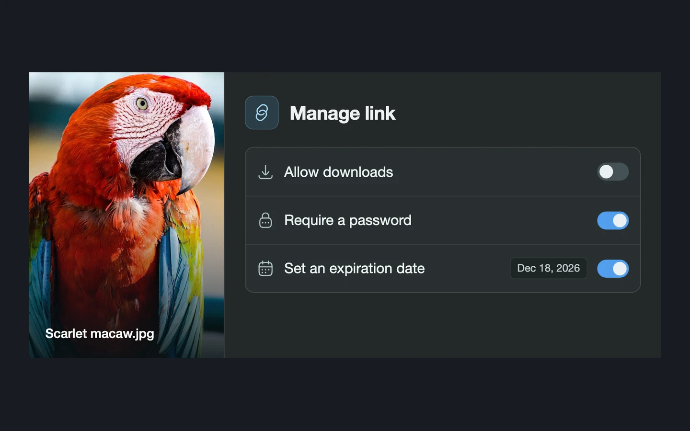

<p align="center" class="filament-hidden">
  <picture>
    <source media="(prefers-color-scheme: dark)" srcset="art/readme/logo-dark.svg">
    
  </picture>
</p>

<h1 align="center">FLEX Media Studio<br>Your media. One Studio.</h1>

<p align="center">
  <strong>A self-hosted media workspace for Laravel. At home in Filament.</strong>
</p>

<p align="center">
  Bring images, videos and documents into one searchable library.<br>
  Organize with your team, preview and edit assets, and reuse them across your application.<br>
  Add contextual AI, browser capture and your own storage — on your terms.
</p>

<p align="center">
  <a href="https://github.com/janczakb/media-studio/stargazers"></a>
  
  
  
  
</p>

<p align="center">
  <a href="https://studio.bjanczak.com/"></a>&nbsp;
  <a href="https://studio.bjanczak.com/filament"></a>
</p>

<p align="center">
  <a href="#why-choose-media-studio"><strong>Why Studio?</strong></a> &nbsp;·&nbsp;
  <a href="#filament-components"><strong>Filament components</strong></a> &nbsp;·&nbsp;
  <a href="#getting-started"><strong>Getting started</strong></a>
</p>

<p align="center" class="filament-hidden">
  <a href="https://studio.bjanczak.com/">
    
  </a>
</p>

<p align="center">
  <sub>This repository is the public product overview. Package source and installable builds are not included here.</sub>
</p>

## Why choose Media Studio?

| What makes Studio worth choosing | What it gives your application |
| --- | --- |
| **Every asset. One library.** | Images, video, audio and documents in workspaces with folders, tags, favorites, comments and shared access. |
| **Find it. Search by meaning.** | Search names and tags, narrow results with filters, and enable content indexing, OCR and semantic retrieval when your installation needs them. |
| **Ask naturally. Act in context.** | An optional assistant that understands authorized library context and can find, tag and organize files through conversation. |
| **Your media. Your infrastructure.** | Self-hosted Laravel storage with local and S3-compatible disks, configurable CDN delivery, tenant isolation and role-based permissions. |
| **One asset. Reused across your app.** | Pick existing media in forms and editors using durable asset/version references, without uploading another copy just to select it. |
| **Found online. Saved to Studio.** | A browser extension for drag and drop, batch saving, screenshots, context-menu capture and bookmarks. |

Use Studio as a media workspace, embed its React interface in your application, or connect it to **Filament**. FLEX Fields is an optional integration; the library and native Filament components work independently of it.

## See what you can build

<table>
  <tr>
    <td width="50%" valign="top">
      <a href="https://studio.bjanczak.com/filament"></a>
      <p><strong>Your library, inside your forms</strong><br>Choose existing assets, upload to an approved destination and reuse images in editor content.</p>
      <p><a href="https://studio.bjanczak.com/filament">Explore Filament integration →</a></p>
    </td>
    <td width="50%" valign="top">
      <a href="https://studio.bjanczak.com/ai"></a>
      <p><strong>Make visual content easier to discover</strong><br>Enable AI labels, descriptions and OCR, then connect the information to your search workflow.</p>
      <p><a href="https://studio.bjanczak.com/ai">Explore AI capabilities →</a></p>
    </td>
  </tr>
  <tr>
    <td width="50%" valign="top">
      <a href="https://studio.bjanczak.com/browser-extension"></a>
      <p><strong>Capture inspiration while you browse</strong><br>Save images, collect a batch or capture part of a page into an authorized Studio workspace.</p>
      <p><a href="https://studio.bjanczak.com/browser-extension">Explore the browser extension →</a></p>
    </td>
    <td width="50%" valign="top">
      <a href="https://studio.bjanczak.com/sharing"></a>
      <p><strong>Share on your terms</strong><br>Control link passwords, expiration and download access while keeping workspace permissions in place.</p>
      <p><a href="https://studio.bjanczak.com/sharing">Explore sharing →</a></p>
    </td>
  </tr>
</table>

## Filament components

Bring the same media library into fields, editor attachments, tables, record details and actions. Configure accepted types, selection counts, upload destinations and browse scope in PHP.

| Component or integration | Use it for |
| --- | --- |
| **[Studio Media Picker](https://studio.bjanczak.com/filament-media-picker)** | Select and reorder existing assets with list or grid previews, optional uploads and custom file actions. |
| **[Studio FileUpload](https://studio.bjanczak.com/filament-studio-file-upload)** | Connect native Filament uploads to a workspace and optionally choose existing Studio media. |
| **[Studio Media Column](https://studio.bjanczak.com/filament-media-column)** | Show authorized thumbnail previews in tables, with square, circular or stacked presentations. |
| **[Studio Media Entry](https://studio.bjanczak.com/filament-media-entry)** | Present saved media in infolists and record details. |
| **[RichEditor](https://studio.bjanczak.com/filament-rich-editor)** | Insert Studio images through the native editor, including configured ready image conversions. |
| **[MarkdownEditor](https://studio.bjanczak.com/filament-markdown-editor)** | Choose authorized images for Markdown content. |
| **[StudioPicker and actions](https://studio.bjanczak.com/filament-actions)** | Build an application-specific selection action around the Studio modal. |
| **[FLEX Fields](https://studio.bjanczak.com/flex-fields)** | Keep the FLEX upload and FlexRichEditor experience while connecting to Studio storage and references. |

### Choose images from an approved library

This example assumes Studio and its matching browser assets are installed. Resolve `$workspaceId` and `$approvedImagesFolderId` from trusted application context.

```php
use UseFlex\MediaStudio\Integrations\Filament\StudioMediaPicker;

StudioMediaPicker::make('gallery')
    ->studio(
        $workspaceId,
        '/studio-assets/studio.js',
        '/studio-assets/studio.css',
    )
    ->scopedFolder($approvedImagesFolderId)
    ->acceptedFileTypes(['image/jpeg', 'image/png', 'image/webp'])
    ->multiple()
    ->minFiles(1)
    ->maxFiles(8)
    ->layout('grid')
    ->layoutSwitcher(false)
    ->reorderable()
    ->allowUpload(false);
```

The field stores pinned media references. Cast the model attribute to `array` for a multiple field. Selecting an existing asset does not transfer its original bytes again. Configure [reference persistence and usage tracking](https://studio.bjanczak.com/filament-media-references) alongside your normal model-saving flow.

### Upload PDFs into a fixed destination

```php
use UseFlex\MediaStudio\Integrations\Filament\StudioFileUpload;

StudioFileUpload::make('document')
    ->studio(
        workspace: $workspaceId,
        moduleUrl: '/studio-assets/studio.js',
        stylesheetUrl: '/studio-assets/studio.css',
        uploadFolder: $documentsFolderId,
        acceptedMimeTypes: ['application/pdf'],
        allowLibrarySelection: true,
    )
    ->maxSize(10 * 1024)
    ->openable();
```

Workspace permissions, accepted file policies and server limits still apply. Selecting from the library reuses a reference; uploading a new file enters Studio's storage and processing pipeline. Removing a reference from a form does not delete a shared original.

[Filament setup](https://studio.bjanczak.com/filament-setup) · [All configuration options](https://studio.bjanczak.com/filament-configuration) · [Tenancy](https://studio.bjanczak.com/filament-tenancy) · [FLEX Fields integration](https://studio.bjanczak.com/flex-fields)

## AI that works with your library

Describe the asset or the task instead of reproducing an exact filename. Enable the capabilities your workflow needs; they have independent configuration, processing and access checks.

| Capability | What it adds |
| --- | --- |
| **[Contextual assistant](https://studio.bjanczak.com/assistant)** | Conversations with authorized file context and supported actions such as finding, tagging and organizing assets. |
| **[AI labels and descriptions](https://studio.bjanczak.com/ai-image-labels)** | Visual analysis with reviewable suggestions, separate from manually managed tags. |
| **[OCR](https://studio.bjanczak.com/ai/ocr)** | Text extraction from images and scanned PDF pages using the configured OCR service. |
| **[Semantic and hybrid search](https://studio.bjanczak.com/semantic-search)** | Meaning-based retrieval through Meilisearch's configured embedder. |
| **[AI image editing](https://studio.bjanczak.com/ai/image-editing)** | Generate candidates, review the results and explicitly choose which version to publish. |

Chat, visual analysis, OCR and embeddings can use different providers. Enabling one does not automatically scan the entire library or enable the others. External providers receive the inputs your installation authorizes and sends to them.

[AI setup](https://studio.bjanczak.com/ai/setup) · [Providers](https://studio.bjanczak.com/ai/providers) · [Limits and operations](https://studio.bjanczak.com/ai/operations)

## Store once. Process for the places you use it.

Keep originals on a configured Laravel disk. Generate the image conversions your interface needs, deliver them through the configured storage or CDN, and reuse asset identity across the application.

| Your workflow | Studio's role |
| --- | --- |
| **Image delivery** | Named conversions with configurable dimensions, format, quality and metadata handling. Default native image presets use AVIF. |
| **Document previews** | Optional PDF and document thumbnail processing, plus supported Office and PDF previews in the browser. |
| **Video** | In-browser playback, trimming and optional background poster or playback generation. |
| **Existing libraries** | Optional Spatie Media Library integration and indexed disk sources, without moving originals simply to browse them. |
| **Private delivery** | Authorization-aware file access, configured S3 policies and optional CDN delivery profiles. |
| **Versions and cleanup** | Explicit version publication, configurable replacement policies, Trash and optional retention-based permanent cleanup. |

Conversions and specialized previews depend on enabled processors, supported formats and their runtime dependencies. Queued processing needs a running worker. S3 encryption policies are supported; the separate portable application-encryption driver remains experimental. Studio does not imply that every deployment is fully encrypted.

[Storage](https://studio.bjanczak.com/storage-s3) · [Image conversions](https://studio.bjanczak.com/image-conversions) · [Document thumbnails](https://studio.bjanczak.com/document-thumbnails) · [CDN delivery](https://studio.bjanczak.com/cdn-delivery) · [Encryption](https://studio.bjanczak.com/encryption)

## Capture from the browser. Keep working in Studio.

Save a single image, collect a batch, capture a selected area, or save a page bookmark. Choose the workspace, destination folder and tags in the extension's capture workflow.

The extension connects to your installation through an approved, scoped connection. It supports Chrome and Firefox builds. Its file intake uses Studio's authorized upload workflow; browser capture does not bypass storage limits or workspace policy.

[Install and connect](https://studio.bjanczak.com/browser-extension/install) · [Capture options](https://studio.bjanczak.com/browser-extension/capture) · [Transfers and limits](https://studio.bjanczak.com/browser-extension/transfers)

## Connect your application and your AI tools

| Integration | Where to start |
| --- | --- |
| **React SDK** | [Embed Studio](https://studio.bjanczak.com/embedding) with your transport, theme, locale, branding and configured capabilities. |
| **REST API** | [API documentation](https://studio.bjanczak.com/api/introduction) for application integrations and authenticated media operations. |
| **MCP** | [Connect compatible AI clients](https://studio.bjanczak.com/mcp) with scoped tools, workspace access and operation permissions. |
| **CLI** | [Command-line workflows](https://studio.bjanczak.com/cli) for imports, planning, transfers and automation. |
| **Laravel Boost** | [Studio development guidance and skill](https://studio.bjanczak.com/boost) for coding agents working on integrations. |
| **Plugin center** | [Slack integration](https://studio.bjanczak.com/slack) and configurable application connections. |

The in-app assistant, external MCP access and Boost's development skill serve different purposes. Enable each independently. Neither a client connection nor a coding skill grants access to private media by itself.

## Getting started

**Start with the [installation guide](https://studio.bjanczak.com/installation)** and the distribution available to your application. This public overview repository does not contain the Composer package, React build, CLI archive or browser-extension builds.

The Laravel package declares **PHP 8.3+** and **Laravel 12 or 13**. The interface uses **React 19**. **Spatie Laravel Permission 8** is a core dependency. **Filament 5, FLEX Fields, Spatie Media Library, AI services, search and MCP** are optional integrations with their own dependencies and setup.

1. Install the matching packages and browser assets through your distribution.
2. Configure your authenticatable principal, private storage and workspace access.
3. Apply the relevant migrations and grant the required operation permissions.
4. Choose the standalone interface, embedded React interface or Filament integration.
5. Enable only the processors and integrations your application needs; start their workers as required.

[Installation](https://studio.bjanczak.com/installation) · [Configuration](https://studio.bjanczak.com/configuration) · [Filament setup](https://studio.bjanczak.com/filament-setup) · [Operations](https://studio.bjanczak.com/operations)

## Find the solution your application needs

| You are building… | Start with… |
| --- | --- |
| Product galleries and editorial media | [Studio Media Picker](https://studio.bjanczak.com/filament-media-picker) and [RichEditor](https://studio.bjanczak.com/filament-rich-editor). |
| An approved document library | [Folder-scoped selection](https://studio.bjanczak.com/filament-configuration), [PDF previews](https://studio.bjanczak.com/file-previews) and [sharing](https://studio.bjanczak.com/sharing). |
| A multi-company application | [Tenant isolation](https://studio.bjanczak.com/tenancy) and [Filament tenancy](https://studio.bjanczak.com/filament-tenancy). |
| A searchable visual archive | [AI labels](https://studio.bjanczak.com/ai-image-labels), [OCR](https://studio.bjanczak.com/ai/ocr) and [semantic search](https://studio.bjanczak.com/semantic-search). |
| An existing media collection | [Spatie Media Library](https://studio.bjanczak.com/spatie-media-library) or [indexed disk sources](https://studio.bjanczak.com/existing-disk-sources). |
| A team capture workflow | [Browser extension](https://studio.bjanczak.com/browser-extension), [members](https://studio.bjanczak.com/members) and [comments](https://studio.bjanczak.com/comments). |
| Automated imports and external tools | [CLI](https://studio.bjanczak.com/cli), [REST API](https://studio.bjanczak.com/api/introduction) and [MCP](https://studio.bjanczak.com/mcp). |

## Questions before you integrate

<details>
<summary><strong>Do I need Filament or FLEX Fields?</strong></summary>

No. The Laravel library and React interface are independent. Filament provides optional form, table, infolist and editor adapters. FLEX Fields adds an optional integration with its own upload and rich-editor components.

</details>

<details>
<summary><strong>Does choosing a Studio file upload it again?</strong></summary>

No. Library selection stores an asset/version reference. A new upload creates media through the upload pipeline. Reusing an existing file does not create a second binary copy just because another form selected it.

</details>

<details>
<summary><strong>Can I restrict a field to PDFs, images or a specific folder?</strong></summary>

Yes. Configure the supported adapter's MIME allowlist, browse scope, upload destination and minimum/maximum selection count. Client controls guide selection; the server rechecks access and the configured constraints when resolving the result.

</details>

<details>
<summary><strong>Does Studio require AI or a search service?</strong></summary>

No. The core library works without generative AI or Meilisearch. The assistant, visual analysis, OCR and semantic search are independently configured optional capabilities.

</details>

<details>
<summary><strong>Can I keep my existing Spatie Media Library?</strong></summary>

Yes. The optional adapter indexes existing media and works with your configured models, collections and conversions. It does not require copying every original into a new directory just to browse it.

</details>

<details>
<summary><strong>Do large folders load the entire library into the browser?</strong></summary>

Folder navigation and large lists use paginated requests and virtualized views. Breadcrumbs return a bounded context instead of requiring the full ancestry in every response. Your dataset, indexes, processors and deployment still determine actual performance.

</details>

<details>
<summary><strong>Where are the source code, downloads and license terms?</strong></summary>

This repository currently publishes the product overview and presentation assets only. Follow the documentation for integration guidance. No package release, download availability or software-license grant is implied by this README.

</details>

## Part of the FLEX family

| Product | What it brings |
| --- | --- |
| **[FLEX Fields](https://github.com/janczakb/filament-flex-fields)** | Advanced Filament form components, including uploads and rich editing that can connect to Media Studio. |
| **[FLEX Theme](https://github.com/janczakb/filament-flex-theme)** | A coordinated panel experience with visual theme configuration and light/dark presentation. |
| **FLEX Media Studio** | A shared, self-hosted media workspace for your Laravel application and its integrations. |

Each product has its own installation and configuration. Use the combination your application needs.

## Build your media workflow with Studio

Choose how your team captures, organizes and reuses files. Keep the library connected to the storage, forms and tools you use.

**[Explore the documentation](https://studio.bjanczak.com/)** · **[Filament components](https://studio.bjanczak.com/filament)** · **[AI capabilities](https://studio.bjanczak.com/ai)** · **[Browser extension](https://studio.bjanczak.com/browser-extension)**

If Studio fits your workflow, [star the repository](https://github.com/janczakb/media-studio/stargazers) to help other Laravel and Filament developers discover it.

© 2026 Bartłomiej Janczak.
